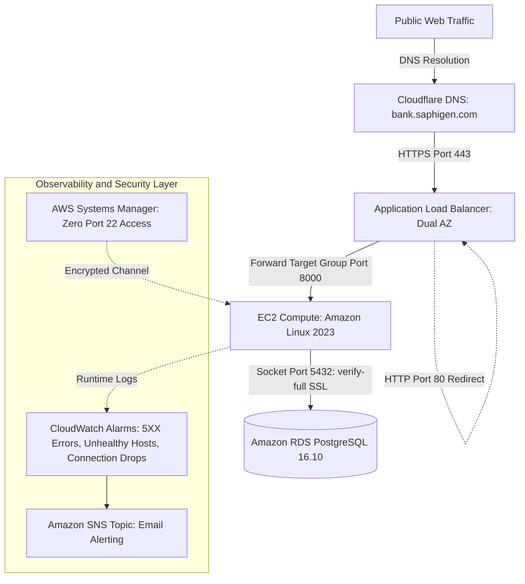

# Sabay Premium Bank: Core Ledger Cloud Migration

Sabay Premium Bank migrated its core transaction ledger from an on premises Linux server to Amazon Web Services in Stockholm (eu-north-1). The project established a three tier VPC using HashiCorp Terraform, replatformed relational persistence to Amazon RDS PostgreSQL 16.10 with enforced TLS transport encryption, locked down compute access using AWS Systems Manager with zero open SSH ports, and executed a 100,000 row scale migration benchmark with automated rollback verification.

## Architecture Blueprint

*(Note: To display your custom high resolution architecture graphic here, save your diagram image to `docs/assets/architecture-diagram.png`)*

## Engineering Implementation Status

| System Capability | Implementation Scope | Verification Status | Primary Evidence Source |
| :--- | :--- | :--- | :--- |
| HTTPS & TLS 1.3 Termination | Custom domain bank.saphigen.com via ACM | Verified | docs/evidence/2026-11-08-tls-1-3-proof.txt |
| HTTP to HTTPS 301 Redirect | ALB port 80 listener redirecting to 443 | Verified | docs/evidence/2026-11-08-tls-1-3-proof.txt |
| Database Transport Encryption | RDS force_ssl with sslmode=verify-full | Verified | docs/evidence/2026-11-08-rds-ssl-verify-full-proof.txt |
| Zero Open SSH Ports | AWS Systems Manager Session Manager | Verified | docs/evidence/2026-11-08-imdsv2-and-encryption-proof.txt |
| IMDSv2 Token Enforcement | EC2 MetadataOptions HttpTokens required | Verified | docs/evidence/2026-11-08-imdsv2-and-encryption-proof.txt |
| KMS Storage Encryption at Rest | gp3 EBS root volume and RDS storage | Verified | docs/evidence/2026-11-08-imdsv2-and-encryption-proof.txt |
| Automated Secret Leak Audit | Gitleaks scan across all 46 commits | Verified | docs/evidence/2026-11-08-gitleaks-audit-proof.txt |
| Point in Time Database Restore | Automated recovery to new instance timed | Verified | docs/evidence/2026-11-08-rds-pitr-proof.txt |
| 100k Row Scale Migration | 20,000 clients and 80,000 ledger transactions | Verified | docs/evidence/timings.md |
| Emergency Rollback Drill | Reconciled transaction 80001 to local DB | Verified | docs/evidence/timings.md |
| CloudWatch Alarms & SNS Alerting | ALB 5XX, Unhealthy Hosts, and Connection drops | Verified | docs/evidence/2026-11-08-alarms-trigger-proof.txt |
| FinOps Spending Limit | AWS Budgets alert set at 10.00 USD | Verified | docs/evidence/2026-11-07-aws-budget-creation.txt |
| Cross Region Pilot Light | Secondary region replica in Ireland | Designed | docs/decisions/ADR-009-disaster-recovery-strategy.md |
| Microservices on Kubernetes | Decoupled Account and Settlement manifests | Designed | kubernetes/ (Manifests authored) |
| Amazon Route 53 DNS Failover | Global latency and health routing | Planned | Deferred to multi region expansion |

## Measured Benchmark Results

All figures represent exact numbers measured during live execution drills:

| Measured Dimension | Metric Value | Verification Details |
| :--- | :--- | :--- |
| Migrated Database Tables | 2 Tables | customers and orders tables |
| Migrated Record Count | 100,000 Rows | 20,000 corporate clients and 80,000 ledger transactions |
| Checksum Mismatches | 0 Mismatches | Verified exact parity between source and target |
| Snapshot Migration Duration | 42.18 Seconds | Time to download dump from S3 and restore to RDS |
| Rollback Drill Duration | Under 2 Seconds | Time to restore write access and reconcile transaction 80001 |
| Negotiated Web TLS Protocol | TLSv1.3 | Cipher: TLS_AES_128_GCM_SHA256 |
| Database CA Transport Validation | verify-full | Amazon RDS global bundle authenticated |
| Point in Time Restore Duration | 452 Seconds | Full creation and available state for new RDS instance |
| Actual Cloud Expenditure | $5.00 USD | Total spend across full three day run, preserving credit balance |

## Architecture Decision Records (ADRs)
| ADR Identifier | Focus Area | Evaluated Tradeoffs | Selected Approach | Decision Record |
| :--- | :--- | :--- | :--- | :--- |
| **ADR 001** | Baseline Source Stack | FastAPI vs Django / SQLite vs PostgreSQL | FastAPI and PostgreSQL 16 on Docker Compose | [View Record](docs/decisions/ADR-001-source-environment-baseline.md) |
| **ADR 002** | Cloud Migration Strategy | Terraform vs CloudFormation / Rehost vs Replatform | Staged Replatforming managed via Terraform | [View Record](docs/decisions/ADR-002-migration-strategy.md) |
| **ADR 003** | Zero Open Port Administration | SSH Bastions vs AWS Systems Manager | Zero open port 22 via AWS SSM Session Manager | [View Record](docs/decisions/ADR-003-zero-open-ports-systems-manager.md) |
| **ADR 004** | Managed Persistence Replatforming | Self Managed EC2 PostgreSQL vs Amazon RDS | Managed Amazon RDS PostgreSQL with automated PITR | [View Record](docs/decisions/ADR-004-managed-rds-postgresql.md) |
| **ADR 005** | Database Replication Methodology | AWS DMS Full Load and CDC vs Native Snapshot Pipe | Cryptographic snapshot pipeline and sequence alignment | [View Record](docs/decisions/ADR-005-database-migration-strategy.md) |
| **ADR 006** | Observability Architecture | Native CloudWatch vs Standalone Splunk SIEM Cluster | Native CloudWatch Alarms with SIEM Firehose Streaming | [View Record](docs/decisions/ADR-006-observability-tooling-cloudwatch-vs-splunk.md) |
| **ADR 007** | Server Migration Methodology | AWS MGN Block Rehosting vs Container Rebuild | Clean Container Rebuilding with Terraform | [View Record](docs/decisions/ADR-007-mgn-feasibility.md) |
| **ADR 008** | Modernization Architecture | Modular Monolith vs ECS Fargate vs Amazon EKS | Managed Kubernetes on Amazon EKS with HPA | [View Record](docs/decisions/ADR-008-modernization-eks-vs-modular-monolith.md) |
| **ADR 009** | Disaster Recovery Strategy | Backup/Restore vs Pilot Light vs Active/Active | Pilot Light with Amazon RDS Cross Region Read Replica | [View Record](docs/decisions/ADR-009-disaster-recovery-strategy.md) |
| **ADR 010** | Cutover and Reversal Boundaries | Immediate DNS vs Pre-Cutover TTL Reduction | Route 53 Health Checks with Post Write Reconciliation | [View Record](docs/decisions/ADR-010-dns-cutover-and-rollback-boundaries.md) |
| **ADR 011** | Secrets and Key Encryption | Plaintext Files vs SSM Parameter Store vs Secrets Manager | AWS Secrets Manager with KMS Envelope Encryption | [View Record](docs/decisions/ADR-011-secrets-management-kms-encryption.md) |
| **ADR 012** | FinOps and Network Egress | Multi-AZ NAT Gateway vs Direct IGW Route | Direct IGW Egress with Strict Security Group Referencing | [View Record](docs/decisions/ADR-012-finops-nat-gateway-cost-exclusion.md) |

## Repository Technical Documentation Matrices

### System Blueprints and Cloud Architecture Specifications
| Specification Document | Engineering Domain | Architectural Deliverable | Direct Access |
| :--- | :--- | :--- | :--- |
| **Baseline Architecture Specification** | On Premises Source | Single host Linux Docker Compose topology and persistence model | [Open Specification](docs/architecture/current-state.md) |
| **Cloud Foundation Specification** | AWS Landing Zone | Multi tier VPC, dual AZ subnets, route tables, and security groups | [Open Specification](docs/architecture/cloud-foundation.md) |
| **Workload Migration Assessment** | Migration Planning | Stateless vs stateful decomposition, RTO and RPO targets | [Open Assessment](docs/migration-assessment.md) |
| **Security Architecture Review** | Compliance and Hardening | Zero open port 22 audit, private RDS isolation, secrets protection | [Open Audit](docs/security-review.md) |
| **Tool Stack and Communication Mapping** | Systems Integration | Component inventory, protocols, ports, and data flows | [Open Architecture Mapping](docs/architecture/tool-stack-and-communications.md) |
| **Modernized Architecture Specification** | Kubernetes Modernization | Amazon EKS cluster architecture, pod boundaries, HPA scaling | [Open Specification](docs/architecture/modernized-state.md) |
| **Disaster Recovery Plan** | Business Continuity | Multi Region failover plan, RTO and RPO targets, and failback SOP | [Open Plan](docs/disaster-recovery-plan.md) |

### Operational Runbooks and Production Incident Analysis
| Operational Document | Operational Domain | Practical Value and Scope | Direct Access |
| :--- | :--- | :--- | :--- |
| **Engineering Incident Post Mortems** | SRE and Failure Analysis | Root cause analyses and exact code fixes for 9 production incidents | [Open Post Mortems](docs/troubleshooting-log.md) |
| **Source Environment Runbook** | Operations SOP | Command reference for building, testing, backing up, and restoring | [Open Runbook](docs/source-environment-runbook.md) |
| **Cloud Operations Runbook** | Site Reliability Engineering | SOP for handling ALB 5XX alerts and database connection drops | [Open Runbook](docs/operations-runbook.md) |
| **Engineering Field Manual** | Self-Service Build Guide | Complete implementation manual with runnable commands | [Open Field Manual](docs/engineering-field-manual.md) |
| **Project Delivery Status Tracker** | Governance and Milestones | Phase sign offs and completion evidence across all phases | [Open Status](docs/project-status.md) |

### Migration Execution Reports and Validation Evidence
| Migration Report | Verification Domain | Quantitative Evidence and Result | Direct Link |
| :--- | :--- | :--- | :--- |
| **Baseline Verification Metrics** | Source QA Testing | Automated test results and deterministic 3 customer / 5 transaction catalog | [Open Metrics](docs/baseline-metrics.md) |
| **Database Migration Report** | Persistence Migration | PostgreSQL 16.10 replatforming, SSL enforcement, sequence sync | [Open Report](docs/database-migration-report.md) |
| **Cutover and Rollback Execution Report** | Business Continuity | Maintenance window execution, traffic switch, and data reconciliation | [Open Report](docs/cutover-report.md) |
| **Server Migration Feasibility Assessment** | Rehosting Strategy | AWS MGN block level replication evaluation vs container rebuilding | [Open Assessment](docs/mgn-feasibility-assessment.md) |
| **Master Portfolio Case Study Report** | Executive Retrospective | Complete 11 phase retrospective, master topology, and FinOps audit | [Open Master Report](docs/master-portfolio-report.md) |
| **Portfolio Website Master Brief** | Web Case Study Copy | Copy and prompt for portfolio website builders | [Open Master Brief](docs/portfolio-case-study-brief.md) |

## Evidence Archive Index

Every technical assertion in this repository maps to dated evidence files:
1. `docs/evidence/2026-11-07-aws-budget-creation.txt`: AWS Budget ceiling configuration.
2. `docs/evidence/2026-11-08-tls-1-3-proof.txt`: OpenSSL handshake output and curl redirect headers.
3. `docs/evidence/2026-11-08-https-healthz-proof.txt`: HTTP/2 200 response on bank.saphigen.com.
4. `docs/evidence/2026-11-08-rds-ssl-verify-full-proof.txt`: pg_stat_ssl query output proving TLS transport.
5. `docs/evidence/2026-11-08-rds-pitr-proof.txt`: Point in time restore log and measured duration.
6. `docs/evidence/2026-11-08-alarms-trigger-proof.txt`: CloudWatch alarm trigger and auto recovery output.
7. `docs/evidence/2026-11-08-imdsv2-and-encryption-proof.txt`: AWS CLI verification of IMDSv2 and KMS.
8. `docs/evidence/2026-11-08-gitleaks-audit-proof.txt`: Full commit history secret audit report.
9. `docs/evidence/timings.md`: Measured timestamps and durations for 100k row migration and rollback.