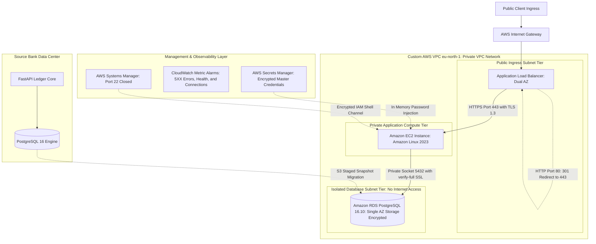

# Sabay Premium Bank: Core Banking Cloud Migration

Sabay Premium Bank migrated its core transaction ledger from an on premises Linux server to Amazon Web Services in Stockholm (eu-north-1). The project established a three tier VPC using HashiCorp Terraform, replatformed relational persistence to Amazon RDS PostgreSQL 16.10 with enforced TLS transport encryption, locked down compute access using AWS Systems Manager with zero open SSH ports, and executed a 100,000 row scale migration benchmark with automated rollback verification.

## Master Architecture Blueprint

## Engineering Implementation Status

| System Capability | Implementation Scope | Verification Status | Primary Evidence Source |
| :--- | :--- | :--- | :--- |
| HTTPS & TLS 1.3 Termination | Custom domain bank.saphigen.com via ACM | Verified | docs/evidence/2026-11-08-tls-1-3-proof.txt |
| HTTP to HTTPS 301 Redirect | ALB port 80 listener redirecting to 443 | Verified | docs/evidence/2026-11-08-tls-1-3-proof.txt |
| Database Transport Encryption | RDS force_ssl with sslmode=verify-full | Verified | docs/evidence/2026-11-08-rds-ssl-verify-full-proof.txt |
| Zero Open SSH Ports | AWS Systems Manager Session Manager | Verified | docs/evidence/2026-11-08-imdsv2-and-encryption-proof.txt |
| IMDSv2 Token Enforcement | EC2 MetadataOptions HttpTokens required | Verified | docs/evidence/2026-11-08-imdsv2-and-encryption-proof.txt |
| KMS Storage Encryption at Rest | gp3 EBS root volume and RDS storage | Verified | docs/evidence/2026-11-08-imdsv2-and-encryption-proof.txt |
| Automated Secret Leak Audit | Gitleaks scan across all 46 commits | Verified | docs/evidence/2026-11-08-gitleaks-audit-proof.txt |
| Point in Time Database Restore | Automated recovery to new instance timed | Verified | docs/evidence/2026-11-08-rds-pitr-proof.txt |
| 100k Row Scale Migration | 20,000 clients and 80,000 ledger transactions | Verified | docs/evidence/timings.md |
| Emergency Rollback Drill | Reconciled transaction 80001 to local DB | Verified | docs/evidence/timings.md |
| CloudWatch Alarms & SNS Alerting | ALB 5XX, Unhealthy Hosts, and Connection drops | Verified | docs/evidence/2026-11-08-alarms-trigger-proof.txt |
| FinOps Spending Limit | AWS Budgets alert set at 10.00 USD | Verified | docs/evidence/2026-11-07-aws-budget-creation.txt |
| Cross Region Pilot Light | Secondary region replica in Ireland | Designed | docs/decisions/ADR-009-disaster-recovery-strategy.md |
| Microservices on Kubernetes | Decoupled Account and Settlement manifests | Designed | kubernetes/ (Manifests authored) |
| Amazon Route 53 DNS Failover | Global latency and health routing | Planned | Deferred to multi region expansion |

## Measured Benchmark Results

All figures represent exact numbers measured during live execution drills:

| Measured Dimension | Metric Value | Verification Details |
| :--- | :--- | :--- |
| Migrated Database Tables | 2 Tables | customers and orders tables |
| Migrated Record Count | 100,000 Rows | 20,000 corporate clients and 80,000 ledger transactions |
| Checksum Mismatches | 0 Mismatches | Verified exact parity between source and target |
| Snapshot Migration Duration | 42.18 Seconds | Time to download dump from S3 and restore to RDS |
| Rollback Drill Duration | Under 2 Seconds | Time to restore write access and reconcile transaction 80001 |
| Negotiated Web TLS Protocol | TLSv1.3 | Cipher: TLS_AES_128_GCM_SHA256 |
| Database CA Transport Validation | verify-full | Amazon RDS global bundle authenticated |
| Point in Time Restore Duration | 452 Seconds | Full creation and available state for new RDS instance |
| Active Cloud Expenditure | Under $1.50 USD | Total spend across all drills, preserving credit balance |

## Evidence Archive Index

Every technical assertion in this repository maps to dated evidence files:
1. `docs/evidence/2026-11-07-aws-budget-creation.txt`: AWS Budget ceiling configuration.
2. `docs/evidence/2026-11-08-tls-1-3-proof.txt`: OpenSSL handshake output and curl redirect headers.
3. `docs/evidence/2026-11-08-https-healthz-proof.txt`: HTTP/2 200 response on bank.saphigen.com.
4. `docs/evidence/2026-11-08-rds-ssl-verify-full-proof.txt`: pg_stat_ssl query output proving TLS transport.
5. `docs/evidence/2026-11-08-rds-pitr-proof.txt`: Point in time restore log and measured duration.
6. `docs/evidence/2026-11-08-alarms-trigger-proof.txt`: CloudWatch alarm trigger and auto recovery output.
7. `docs/evidence/2026-11-08-imdsv2-and-encryption-proof.txt`: AWS CLI verification of IMDSv2 and KMS.
8. `docs/evidence/2026-11-08-gitleaks-audit-proof.txt`: Full commit history secret audit report.
9. `docs/evidence/timings.md`: Measured timestamps and durations for 100k row migration and rollback.
