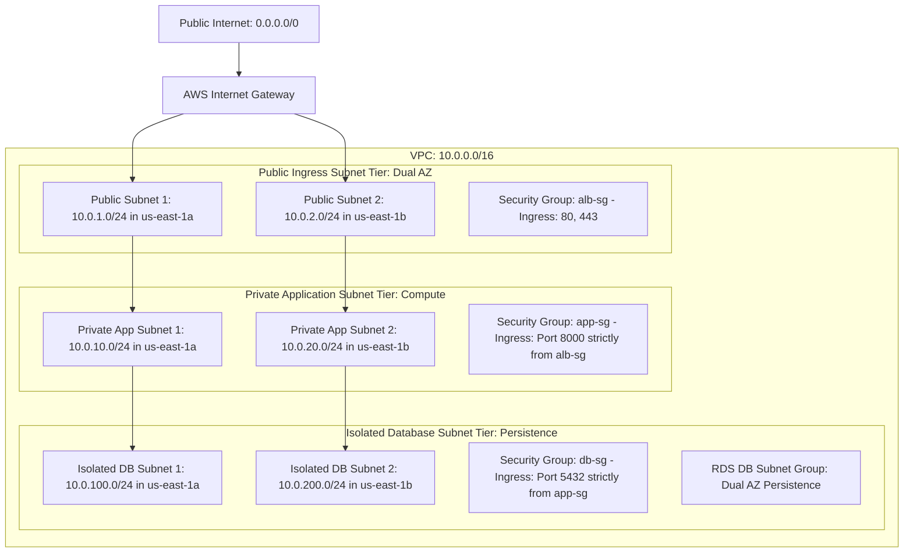

# Cloud Foundation Architecture Specification: Multi Tier AWS VPC

## Executive Summary
This document establishes the foundational networking architecture deployed in Amazon Web Services. The landing zone provides a defense in depth security posture isolating public ingress, application compute, and database persistence into distinct network tiers across multiple availability zones.

## Network Topology Model

## Subnet Allocation and Routing Matrix
| Subnet Classification | Availability Zone | CIDR Block Allocation | Gateway Route Association | Security Boundary |
| :--- | :--- | :--- | :--- | :--- |
| Public Subnet 1 | us-east-1a | 10.0.1.0/24 | Internet Gateway (0.0.0.0/0) | Ingress perimeter for Application Load Balancers |
| Public Subnet 2 | us-east-1b | 10.0.2.0/24 | Internet Gateway (0.0.0.0/0) | Multi AZ redundancy for public ingress |
| Private App Subnet 1 | us-east-1a | 10.0.10.0/24 | Private Route Table (No IGW) | Dedicated to EC2 application compute |
| Private App Subnet 2 | us-east-1b | 10.0.20.0/24 | Private Route Table (No IGW) | Compute redundancy across availability zones |
| Isolated DB Subnet 1 | us-east-1a | 10.0.100.0/24 | Isolated Route Table (No Egress) | Multi AZ RDS PostgreSQL cluster storage |
| Isolated DB Subnet 2 | us-east-1b | 10.0.200.0/24 | Isolated Route Table (No Egress) | Multi AZ RDS PostgreSQL standby replica |

## Security Group Defense in Depth Matrix
| Security Group Identifier | Ingress Source | Allowed Ports / Protocols | Egress Target | Operational Scope |
| :--- | :--- | :--- | :--- | :--- |
| apex-oms-dev-alb-sg | 0.0.0.0/0 (Public Internet) | Port 80 (HTTP), Port 443 (HTTPS) | All Traffic (0.0.0.0/0) | Public load balancer traffic termination |
| apex-oms-dev-app-sg | apex-oms-dev-alb-sg (SG Reference) | Port 8000 (ASGI Application) | All Traffic (0.0.0.0/0) | Application instances protected from direct web scans |
| apex-oms-dev-db-sg | apex-oms-dev-app-sg (SG Reference) | Port 5432 (PostgreSQL) | Denied (No Outbound Egress) | Managed database protected from compute compromises |
