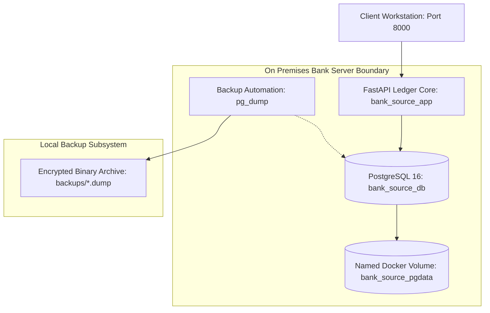

# Baseline Architecture Specification: On Premises Core Ledger Environment

## Executive Briefing
| Attribute | Specification | Operational Target |
| :--- | :--- | :--- |
| Workload Classification | Core Banking Ledger and Settlement System | Commercial Banking and Treasury Operations |
| Current Hosting Model | Single Host Linux Server (Docker Compose) | Target: AWS Cloud Replatforming |
| Primary SLA Target | 99.9 Percent Availability | Zero Data Loss (RPO Zero for Financial Transactions) |
| Active Compute Engine | Python 3.12 with FastAPI Framework | Asynchronous ASGI Worker Model |
| Active Database Engine | PostgreSQL 16 Alpine Distribution | ACID Relational Model |

## Layer Specifications Matrix

### Compute Subsystem
| Parameter | Configuration | Technical Justification |
| :--- | :--- | :--- |
| ASGI Web Server | Uvicorn Standard | Asynchronous non blocking socket processing for concurrent financial queries |
| API Framework | FastAPI 0.110.0 | High performance request validation and OpenAPI automation |
| Object Relational Mapper | SQLAlchemy 2.0 Core | Thread safe connection pooling with pre ping socket validation |
| Connection Pool Ceiling | 10 persistent sockets, 20 overflow sockets | Protects PostgreSQL from connection exhaustion during transaction spikes |
| Healthcheck Mechanism | Active Database Query (SELECT 1) | Prevents routing traffic to unhealthy ledger compute nodes |

### Persistence Subsystem
| Parameter | Configuration | Technical Justification |
| :--- | :--- | :--- |
| Database Engine | PostgreSQL 16.4 Alpine | Standards compliant relational engine with logical decoding for replication |
| Storage Architecture | Named Docker Volume: bank_source_pgdata | Isolates database disk pages from container lifecycle events |
| Foreign Key Policies | ON DELETE CASCADE | Enforces strict referential integrity between customer accounts and transactions |
| Sequence Alignment | Explicit setval invocation at startup | Prevents primary key collisions during post migration ledger writes |
| Binary Backup Tooling | pg_dump custom format (-Fc) | Compressed point in time snapshots with checksum validation |

### Network and Ingress Topology
| Network Identifier | Driver Type | Exposed Endpoints | Security Scope |
| :--- | :--- | :--- | :--- |
| bank_source_network | Linux Bridge | Port 8000 (App), Port 5432 (DB) | Isolated internal banking subnet |
| Host Interface | IPv4 Loopback and Interface Binding | 0.0.0.0:8000, 0.0.0.0:5432 | Development testing and monitoring access |
