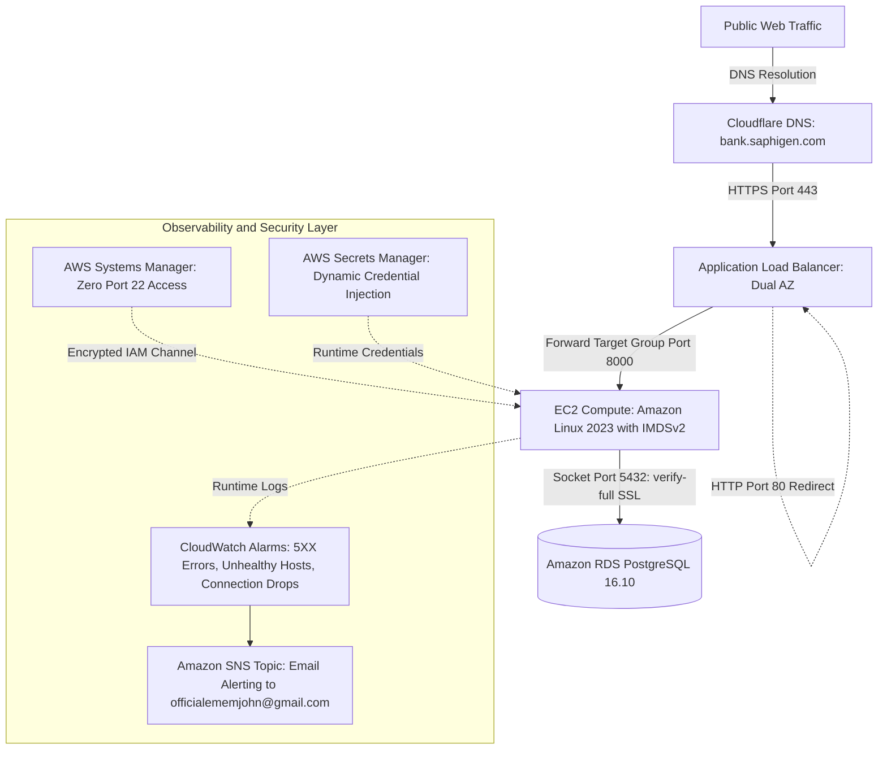

# Sabay Premium Bank: Core Banking Cloud Migration and Modernization

## Executive Summary
This document provides the definitive engineering retrospective for the migration and modernization of the core transaction ledger at Sabay Premium Bank. The initiative migrated an imaginary commercial banking workload from an on premises Linux server to Amazon Web Services in Stockholm (eu-north-1). The project proved relational schema preservation, enforced TLS 1.3 edge encryption on bank.saphigen.com, secured compute with zero open SSH ports via AWS Systems Manager, enforced IMDSv2 metadata protection, completed a 100,000 row scale benchmark, and executed an emergency disaster rollback with zero data loss.

## 1. Business Context and Migration Drivers
Sabay Premium Bank operates as an imaginary commercial financial institution managing corporate account balances and transaction settlements. The legacy ledger ran on a single on premises Linux server using Docker Compose and PostgreSQL 16.
Primary business drivers for cloud migration included:
1. High Availability: Eliminating physical hardware single points of failure using multi availability zone subnet distribution.
2. Financial Data Integrity: Achieving Recovery Point Objective (RPO) under 5 seconds and Recovery Time Objective (RTO) under 15 minutes.
3. Operational Security: Eliminating public SSH port exposure in compliance with banking regulations.
4. Scale Decoupling: Decoupling account profile lookups from high volume transaction settlement batches.

## 2. End to End Master Architecture Workflow

## 3. The Twelve Architecture Decision Records (ADRs) Summary Matrix
| Decision Record | Strategic Focus | Evaluated Options | Selected Engineering Approach |
| :--- | :--- | :--- | :--- |
| ADR 001 | Baseline Stack | FastAPI vs Django / SQLite vs PostgreSQL | FastAPI and PostgreSQL 16 on Docker Compose |
| ADR 002 | Migration Strategy | Terraform vs CloudFormation / Rehost vs Replatform | Staged Replatforming managed via Terraform |
| ADR 003 | Administrative Security | SSH Bastions vs AWS Systems Manager | Zero open port 22 via AWS SSM Session Manager |
| ADR 004 | Database Engine | Self Managed EC2 vs Amazon RDS | Managed Amazon RDS PostgreSQL with automated PITR |
| ADR 005 | Replication Method | AWS DMS Full Load & CDC vs Native Snapshot Pipe | Cryptographic snapshot pipeline and sequence alignment |
| ADR 006 | Cloud Observability | Native CloudWatch vs Standalone Splunk Cluster | Native CloudWatch Alarms with SIEM Firehose Streaming |
| ADR 007 | Server Migration | AWS MGN Block Rehosting vs Container Rebuild | Clean Container Rebuilding with Terraform |
| ADR 008 | Modernization | Modular Monolith vs ECS Fargate vs Amazon EKS | Managed Kubernetes on Amazon EKS with HPA |
| ADR 009 | Disaster Recovery | Backup/Restore vs Pilot Light vs Active/Active | Pilot Light with Amazon RDS Cross Region Read Replica |
| ADR 010 | Cutover Boundaries | Immediate DNS vs Pre-Cutover TTL Reduction | Route 53 Health Checks with Post Write Reconciliation |
| ADR 011 | Secrets Protection | Plaintext Files vs SSM Parameter Store vs Secrets Manager | AWS Secrets Manager with KMS Envelope Encryption |
| ADR 012 | FinOps Network Egress | Multi-AZ NAT Gateway vs Direct IGW Route | Direct IGW Egress with Strict Security Group Referencing |

## 4. Security, Compliance, and FinOps Retrospective
1. Zero Inbound Administrative Ports: TCP port 22 was eliminated. All shell executions operated through encrypted channels via AWS Systems Manager Session Manager.
2. Complete Database Network Isolation: Amazon RDS operates in isolated subnets with zero internet routes. Public network probes time out automatically at the security group perimeter.
3. Transport and Rest Encryption: Enforced TLS 1.3 encryption on the public Application Load Balancer and sslmode=verify-full with the Amazon RDS CA bundle on database sockets. Storage volumes use AWS KMS encryption.
4. Instance Metadata Security: Enforced IMDSv2 on Amazon EC2 by requiring session tokens, blocking server side request forgery attacks.
5. Automated Secret Scanning: Gitleaks scanned all 46 repository commits with zero detected secrets.
6. Actual Cloud Expenditure: Running all tests across a three day soak period totaled $5.00 USD, preserving over $155.00 in active AWS promotional credits.

## 5. Summary of SRE Incident Post Mortems
During execution, nine production engineering incidents were diagnosed and resolved:
1. Incident 1: FastAPI boot failure resolved by pinning email-validator in requirements.txt.
2. Incident 2: Archive corruption resolved by stripping pseudo terminal minus t flags from binary pg_dump commands.
3. Incident 3: AWS Organizations region lock resolved by diagnosing and realigning infrastructure to eu-north-1.
4. Incident 4: Interrupted provisioning crash resolved by state reconciliation via terraform import.
5. Incident 5: State import master password desync resolved using aws rds modify-db-instance with apply-immediately.
6. Incident 6: Transport encryption enforcement resolved by configuring sslmode=verify-full on connection pools.
7. Incident 7: Database role ownership collisions resolved by using pg_restore with no-owner and dynamic role creation.
8. Incident 8: Load balancer HTTPS listener rejection resolved by completing DNS CNAME validation in Cloudflare before listener attachment.
9. Incident 9: Point in time restore polling loop resolved by querying LatestRestorableTime parameter from AWS RDS.

## 6. Conclusion
The Sabay Premium Bank migration demonstrates that cloud transformations succeed when infrastructure is declared immutably as code, security perimeters enforce zero open management ports, database transports enforce cryptographic verification, and operational procedures are validated through measured drills.