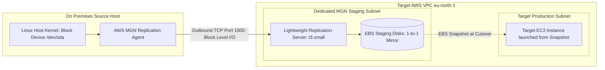

# Server Migration Feasibility Assessment: AWS Application Migration Service (MGN)

## 1. Executive Summary
This document provides an engineering feasibility evaluation of AWS Application Migration Service (AWS MGN) for Sabay Premium Bank. The assessment evaluates block level lift and shift server rehosting against our implemented strategy of automated container rebuilding via HashiCorp Terraform and Amazon Linux 2023.

## 2. AWS MGN Architectural Topology Model

## 3. Technical Prerequisites for AWS MGN Deployment
| Operational Requirement | Technical Specification | Compliance Status |
| :--- | :--- | :--- |
| Supported Source OS | Linux kernel 2.6.32 or newer with root access | Compatible (Ubuntu 24.04 LTS x86_64) |
| Network Egress | Outbound TCP Port 1500 to AWS replication servers | Requires open firewall rules |
| API Control Plane | Outbound HTTPS Port 443 to AWS MGN regional endpoints | Compatible |
| Identity and Access | IAM Role with AWSApplicationMigrationAgentPolicy | Verified |
| Dedicated Staging Area | VPC Subnet with attached low cost staging EBS volumes | Available |

## 4. Architectural Tradeoff and Decision Matrix
| Evaluation Dimension | Block Level Server Rehosting (AWS MGN) | Automated Container Rebuilding (Selected Path) |
| :--- | :--- | :--- |
| Operating System Baseline | Transfers legacy OS clutter, old kernel modules, and unpatched CVEs | Launches clean minimal Amazon Linux 2023 baseline |
| Disaster Recovery Posture | Requires persistent staging replication servers and EBS volumes | Zero persistent staging infrastructure costs |
| Infrastructure as Code | Creates unmanaged virtual machine disk clones | 100 percent declared, reviewable, reproducible Terraform code |
| Security Perimeter | Preserves legacy SSH keys and configuration files | Zero open SSH ports, managed exclusively via AWS Systems Manager |
| Modernization Trajectory | Leaves workloads bound to virtual machine architectures | Immediately aligns workloads for Kubernetes microservices (Phase 9) |

## 5. Architectural Recommendation
For Sabay Premium Bank, we select automated container rebuilding on Amazon EC2 over raw block level server rehosting.

Because our core ledger application is already cleanly containerized and its relational state resides in managed Amazon RDS PostgreSQL, replicating raw disk blocks introduces unnecessary storage expenses and transfers legacy operating system technical debt into AWS. Container rebuilding provides immutability, cleaner security boundaries, and immediate readiness for our Phase 9 modernization on Amazon EKS.
