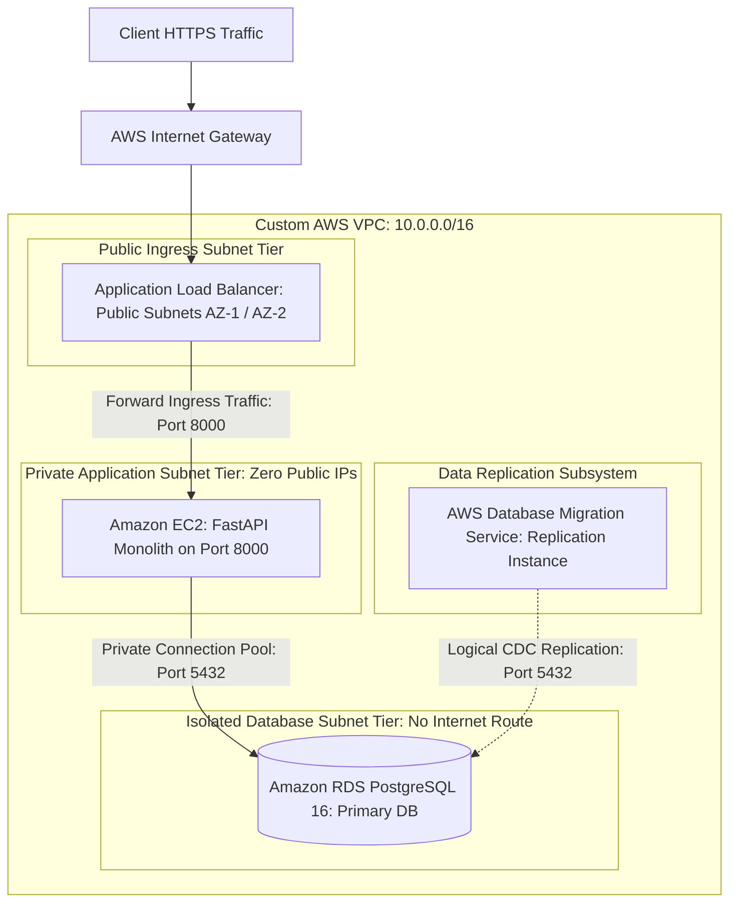

# Workload Migration Assessment and Target Cloud Architecture

## 1. Executive Summary
This document establishes the technical assessment and cloud replatforming design for the Apex Retail Order Management System. The assessment categorizes application components into stateful and stateless subsystems, evaluates network dependencies, and details the target architecture within a dedicated Amazon Web Services Virtual Private Cloud.

## 2. Workload Component Decomposition
| Component Identifier | Tier Classification | State Classification | Migration Target | Target Runtime Justification |
| :--- | :--- | :--- | :--- | :--- |
| FastAPI Web Core | Application Ingress | Stateless | Amazon EC2 (Private Subnet) | Rehosted on Linux instance behind Application Load Balancer |
| SQLAlchemy Engine | Database Client | Stateless | Amazon EC2 Connection Pool | Configured with pre ping socket verification for managed RDS |
| PostgreSQL 16 | Persistence Engine | Stateful | Amazon RDS for PostgreSQL | Replatformed to managed service with automated snapshots |
| Seed Data and Tables | Relational Storage | Stateful | Amazon RDS Multi AZ Storage | Synchronized via AWS Database Migration Service |
| Local Disk Backups | Archival Storage | Stateful Artifacts | Amazon S3 Storage Bucket | Durability increased to eleven nines with versioning |

## 3. Recovery and Availability Objectives
| Operational Metric | Business Tolerance | Target AWS Engineering Objective | Validation Mechanism |
| :--- | :--- | :--- | :--- |
| Recovery Time Objective (RTO) | Maximum 30 Minutes | Under 15 Minutes | Application Load Balancer health check drain and DNS switch |
| Recovery Point Objective (RPO) | Zero Committed Order Loss | Near Zero (Less than 10 Seconds) | AWS DMS Change Data Capture write ahead log replication |
| Target System Availability | 99.5 Percent Monthly | 99.9 Percent Monthly | Dual availability zone subnet distribution and auto restart |

## 4. Network and Security Boundary Specifications
| Subnet Tier | CIDR Block Allocation | Public Route Access | Ingress Rules | Egress Rules |
| :--- | :--- | :--- | :--- | :--- |
| Public Ingress Tier | 10.0.1.0/24, 10.0.2.0/24 | Internet Gateway Route | Port 80 and Port 443 from 0.0.0.0/0 | Port 8000 forward to Private App Tier |
| Private App Tier | 10.0.10.0/24, 10.0.20.0/24 | No Direct Public Route | Port 8000 strictly from ALB Security Group | Port 5432 to Database Tier, HTTPS to SSM |
| Isolated DB Tier | 10.0.100.0/24, 10.0.200.0/24 | Strict No Internet Route | Port 5432 strictly from App Security Group and DMS | Complete outbound egress deny |

## 5. Target Cloud Architecture Design
The target AWS architecture establishes strict defense in depth isolation. Compute instances remain completely unexposed to the public internet, accessible administratively only through AWS Systems Manager Session Manager.

## 6. Migration Feasibility and Risk Analysis
| Risk Factor | Root Technical Cause | Mitigation Architecture |
| :--- | :--- | :--- |
| Primary Key Sequence Desync | Bulk data loading does not advance sequences | Execute sequence realignment script immediately after cutover |
| Network Egress Latency | High volume CDC streaming over public internet | Configure VPN tunnel or direct VPC peering for replication path |
| Application Socket Leaks | Stale connections during RDS automated maintenance | Enforce SQLAlchemy pre ping validation and connection timeout pooling |
| Accidental Data Divergence | Source database accepts writes after traffic cutover | Enforce read only permissions on source database prior to DNS switch |
